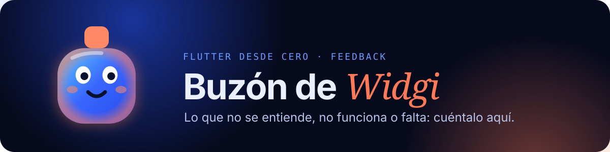

  

Este es el buzón de **[Flutter desde cero](https://flutterdesdecero.pages.dev)**, un curso gratuito de Dart y Flutter en español.

El curso se hace mejor con ayuda de quienes lo usan. Si una explicación no se entendió, un ejemplo falló o falta un tema, escríbelo aquí. Cada mensaje lo lee una persona (Alan), y Widgi lo celebra.

## Elige una puerta

| Si… | Abre… |
| --- | --- |
| Encontraste un error, una explicación confusa o un código que no funciona | [**Error en una lección**](https://github.com/AlanJAquinoC/WEB_flutterdesdecero_feedback/issues/new?template=error-en-leccion.yml) |
| Quieres que se explique algo, o tienes una idea para mejorar el curso | [**Sugerencia**](https://github.com/AlanJAquinoC/WEB_flutterdesdecero_feedback/issues/new?template=sugerencia.yml) |
| El sitio se ve mal, no carga o se rompe en tu dispositivo | [**Problema del sitio**](https://github.com/AlanJAquinoC/WEB_flutterdesdecero_feedback/issues/new?template=problema-tecnico.yml) |
| Solo quieres preguntar o conversar | [**Discusiones**](https://github.com/AlanJAquinoC/WEB_flutterdesdecero_feedback/discussions) |

## Para que te pueda ayudar rápido

- **Pega el enlace de la página** donde pasó (por ejemplo `https://flutterdesdecero.pages.dev/leccion/dart-clases`).
- **Una captura de pantalla** vale más que mil palabras. Puedes arrastrarla al formulario.
- Antes de escribir, [mira si ya existe](https://github.com/AlanJAquinoC/WEB_flutterdesdecero_feedback/issues?q=is%3Aissue). Si es así, deja un 👍 en ese reporte.
- **No pegues datos personales ni contraseñas.** Este repositorio es público.

## Qué pasa después de escribir

| Etiqueta | Significa |
| --- | --- |
| `recibido` | Lo vi y está en la lista. |
| `revisando` | Estoy comprobándolo o pensando cómo mejorarlo. |
| `corregido` | Ya está arreglado y publicado en el sitio. |
| `buena-idea` | Me encantó, pero entra en una próxima ronda. |

## Convivencia

Aquí todos estamos aprendiendo. Se agradece el español claro y amable, y se agradece mucho más cuando algo se explica como si la otra persona estuviera empezando, porque ese es justo el público del curso.

---

Hecho por [Alan Josué Aquino Condori](https://github.com/AlanJAquinoC). Flutter y Dart son marcas de Google LLC; este proyecto es independiente y no está afiliado a Google.
